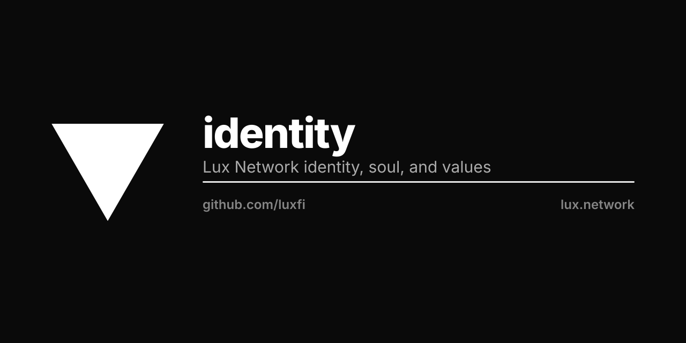

<p align="center"></p>

# Lux Network Identity

**L0 Settlement for the AI Economy.**

This repository contains the core identity, values, and philosophy of the Lux Network.

## Contents

- `soul.md` - The complete soul document defining Lux's identity, values, and principles

## About Lux Network

Lux is a multi-consensus blockchain focused on:
- Post-quantum cryptography
- High-performance Snow consensus
- Cross-chain interoperability
- AI compute settlement layer

## Architecture

```
Lux (L0 Consensus) -> Hanzo (L1 AI Compute) -> Zoo (App Layer) -> Zen (Models)
```

## Related

- [luxfi/brand](https://github.com/luxfi/brand) - Brand guidelines
- [luxfi/logo](https://github.com/luxfi/logo) - Logo assets
- [luxfi/press](https://github.com/luxfi/press) - Press kit
- [luxfi/node](https://github.com/luxfi/node) - Node implementation

## License

BSD-3-Clause
